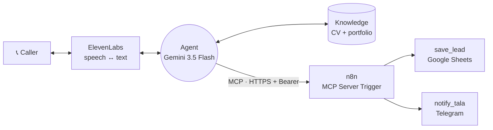

  

> **Demo · real test calls, caller details changed.**

A voice assistant you can call. It answers questions about me and my work from my CV, in Arabic or English, refuses to guess, and saves interested callers as leads through n8n.

On the [project page](https://sfditala.github.io/ai-voice-call-agent/) you can replay real test calls line by line. While the transcript plays, you see which part of the system is working, and every tool call the agent makes, with its real arguments and result.

## Listen in on a test call

| Call | What happens |
|---|---|
| **Book a call** | The agent collects name, phone and need one question at a time, reads them back, and saves without asking permission. In this test the sheet save failed, so it still notified me on Telegram, flagged "(Lead saving failed)" in the message, and told the caller exactly what happened. |
| **Trap questions** | "How much does she charge?", "Is she free Monday at 8?", "I heard she failed at marketing." None of it is in the CV, so it says it isn't sure and offers to take details. |
| **Before the fix** | The very first call. Asked "مين تالا؟", it described me as a digital marketer. The same question after the fix, side by side. |

[▶ Replay the calls](https://sfditala.github.io/ai-voice-call-agent/)

## How it works

Two tools, each doing what it's best at.

- **ElevenLabs owns the conversation:** speech-to-text, the model, the voice, the knowledge base, and switching between Arabic and English.
- **n8n owns the actions:** an MCP Server Trigger exposes two tools. Adding calendar booking or a CRM later is one more tool node, and the voice side doesn't change.
- **One shared token** protects the MCP endpoint. It sits in n8n's Bearer credential and in ElevenLabs' `Authorization` header.

**Stack:** ElevenLabs Agents · Gemini 3.5 Flash · ElevenLabs v4 Turbo · Knowledge Base + RAG · MCP (Streamable HTTP) · n8n · Google Sheets · Telegram Bot API

<b>Design decisions</b>

- **The CV lives in the prompt.** It's small and needed on every call. The portfolio site stays in RAG, with multilingual embeddings because callers ask in Arabic about an English CV.
- **No permission question before saving.** Collect, read back once, save. Asking "should I save this?" invites a no.
- **Promise only what happened.** "Tala will contact you" is said only after a tool actually succeeded.
- **Auto-approve tools.** A voice call can't pause for someone to click "approve".

<b>What broke, and the fix</b>

| What went wrong | The fix |
|---|---|
| The first "Who is Tala?" got an invented career in digital marketing. | The CV moved from auto mode into the prompt, the model changed to Gemini 3.5 Flash, and the prompt now forbids guessing. |
| Realtime voice mode ran its own model and ignored the one I picked. | Read the call logs, saw which model answered, switched the voice mode to Custom. |
| It asked "Do you want me to save your details?", heard "no", saved nothing, and promised a call back anyway. | Saving is part of booking, and the promise comes only after the tool succeeds. |
| The MCP server was added to the workspace but not attached to the agent. | Attach it to the agent, then check the tools are listed before testing. |
| `save_lead` failed with "Sheet with ID 0 not found". A CSV-converted sheet doesn't get tab id 0. | Looked up the real tab id through n8n's resource list. |

## How I built it, step by step

**In n8n: the agent's hands**

1. **Started with the tools, not the voice.** An empty workflow with an **MCP Server Trigger**. Anything the agent should do during a call becomes a tool under this trigger.
2. **Locked the door.** The MCP URL is public, so the trigger uses **Bearer Auth** with a long random token.
3. **Added two tools.** `save_lead` appends a row to Google Sheets, and `notify_tala` sends me a Telegram message. Every field the caller provides uses `$fromAI`, so the agent fills it from the conversation, and each tool's description tells the agent when to use it.

**In ElevenLabs: the voice and the brain**

4. **Created the agent.** A system prompt, a greeting in Arabic and English, Arabic as the default with English detected automatically, and a voice that handles both.
5. **Taught it about me.** My CV and portfolio site went into the Knowledge Base, with the rule that matters most: answer only from these, never guess.

**Connecting the two**

6. **Added n8n as an MCP server.** Tools → MCP → Add custom server, **Streamable HTTP**, the n8n **Production URL**, and the header `Authorization: Bearer <token>`. The first test said "Failed to connect", because the workflow wasn't active yet. After publishing, both tools appeared.
7. **Attached it to the agent.** Adding the server to the workspace isn't enough. It has to be attached to the agent itself.

**Testing, and breaking it on purpose**

8. **First call invented my career** ("a digital marketer"). Fixed with the CV in the prompt, Gemini 3.5 Flash, multilingual embeddings and a stricter no-guessing rule.
9. **It asked permission to save, heard "no", and saved nothing.** Now it collects, reads back once, saves, and promises a follow-up only after the save succeeds.
10. **"Sheet with ID 0 not found."** Found the real tab id through n8n. During that failure the agent still notified me on Telegram and was honest with the caller.
11. **A script of trap questions:** prices, free slots, rumours, corrected details mid-booking, a caller who won't leave details, and switching language mid-call. Each fix was checked against the ElevenLabs call logs and n8n's executions.

## Run it yourself

1. In n8n, go to **Workflows → Import from File** and choose [`workflow.json`](workflow.json).
2. Create a Google Sheet with the columns `name`, `phone`, `request`, `date`, `email`. Replace `YOUR_GOOGLE_SHEET_ID` and pick the tab in `save_lead`.
3. Replace `YOUR_TELEGRAM_CHAT_ID` in `notify_tala`, and press **Start** on your bot once so it can message you.
4. Create a **Bearer Auth** credential with a long random token. Publish the workflow and copy the MCP **Production URL**.
5. In ElevenLabs, create an agent and copy the prompt and settings from [`agent/elevenlabs-agent.json`](agent/elevenlabs-agent.json). Add your CV in **prompt** mode.
6. Add a custom MCP server: **Streamable HTTP**, the Production URL, and the header `Authorization: Bearer YOUR_SHARED_TOKEN`. Attach it to the agent, then test with the trap questions above.

This repo contains no credentials, tokens, agent IDs or real sheet and chat IDs. Personal values are placeholders, and [a check](scripts/check-clean.mjs) runs on every push.

## العربية

مساعد صوتي بتقدر تتصل فيه. بيجاوب عن تالا وشغلها من الـ CV بالعربي أو الإنجليزي، وما بيخمّن أي معلومة، وإذا المتصل مهتم بياخد اسمه ورقمه وشو بده، وبيسجله بـ Google Sheets وبيبعتلي ملخص على تلغرام.

بلّشت من n8n: عملت MCP Server Trigger محمي بـ Bearer token، وتحته أداتين، وحدة بتسجّل العميل بالشيت ووحدة بتبعتلي على تلغرام. بعدين بنيت الـ agent بـ ElevenLabs: البرومبت، والترحيب بالعربي والإنجليزي، والـ CV بالـ Knowledge Base. وبالآخر ربطتهم عن طريق MCP بالرابط والـ token. أول مكالمة اخترع فيها إني مسوقة رقمية 😅، وبعد التصليحات صار يجاوب من الـ CV بس، وبيقول "مش متأكد" بدل ما يخمّن. بصفحة المشروع بتقدر تعيد تشغيل مكالمات تجريبية حقيقية وتشوف كل أداة وهي بتشتغل.

---

Built by <a href="https://portfolio-mauve-seven-44.vercel.app/"><b>Tala Safadi</b></a>, AI Engineer · <a href="https://www.linkedin.com/in/talasfdi">LinkedIn</a> More systems: <a href="https://github.com/Sfditala/clinic-ai-receptionist">Clinic AI Receptionist</a> · <a href="https://github.com/Sfditala/ai-marketing-team">AI Marketing Team</a> · <a href="https://github.com/Sfditala/telegram-personal-assistant">Telegram Personal Assistant</a>

