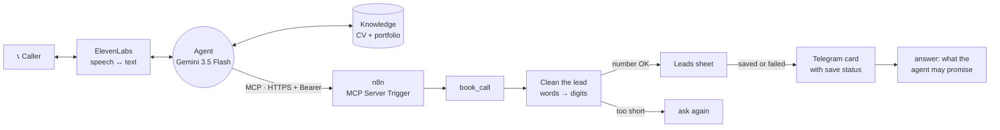

  

> **Demo · real test calls, caller details changed.**

A voice assistant you can call. It answers questions about me and my work from my CV, in Arabic or English, refuses to guess, and books interested callers through n8n with **one tool that saves the lead and tells me, every time**.

On the [project page](https://sfditala.github.io/ai-voice-call-agent/) you can replay real test calls line by line. While the transcript plays, you see which part of the system is working, and every tool call the agent makes, with its real arguments and result.

## Listen in on a test call

Every call on the page is a real test call from the ElevenLabs logs. The first three are **v1** and show the bugs that shaped v2.

| Call | What happens |
|---|---|
| **The lead that got lost** (v1) | The sheet save failed, the model never called `notify_tala`, and handed out my personal email instead. Nobody got the lead. This is why there is one tool now. |
| **حجز بالعربي** (v1) | No read-back, the sheet failed, and Telegram got the phone number as words: "صفر خمسة تسعة…". |
| **Sheet failed, Telegram saved it** (v1) | Same failure, but this time the model remembered to notify me and flag it. It worked only because the model chose to. |
| **Trap questions** | Prices, free slots, a rumour. None of it is in the CV, so it says it isn't sure. |
| **Before the fix** | The very first call described me as a digital marketer. Same question after the fix, side by side. |

[▶ Replay the calls](https://sfditala.github.io/ai-voice-call-agent/)

## How it works

Two tools, each doing what it's best at.

- **ElevenLabs owns the conversation:** speech-to-text, the model, the voice, the knowledge base, and switching between Arabic and English.
- **n8n owns the actions:** an MCP Server Trigger exposes one tool, `book_call`. It runs a sub-workflow in the same file that cleans the data, saves, notifies, and tells the agent what happened. Adding calendar booking or a CRM later is one more tool node, and the voice side doesn't change.
- **One shared token** protects the MCP endpoint. It sits in n8n's Bearer credential and in ElevenLabs' `Authorization` header.

**Stack:** ElevenLabs Agents · Gemini 3.5 Flash · ElevenLabs v4 Turbo · Knowledge Base + RAG · Post-call analysis · MCP (Streamable HTTP) · n8n sub-workflow tool · Google Sheets · Telegram Bot API

<b>Design decisions</b>

- **One tool that can't half-run.** v1 gave the model `save_lead` and `notify_tala` and trusted it to call both. In one real call it didn't, and the lead was lost. `book_call` does both inside n8n, and Telegram goes out even when the sheet fails.
- **Clean data in code, not in the prompt.** Phone numbers spoken as words or in Arabic-Indic digits become plain digits, spelled-out emails become addresses, and a number that isn't 9 or 10 digits goes back to the agent to ask again.
- **The tool says what the agent may promise.** `book_call` returns `saved`, `notified_tala` and the line to say. "Tala will contact you" is allowed only when the lead reached me.
- **A safety net after the call.** ElevenLabs post-call analysis pulls name, phone, request and outcome out of every transcript and grades three checks: read back before saving, promised only what happened, no lead lost.
- **The CV lives in the prompt.** It's small and needed on every call. The portfolio site stays in RAG, with multilingual embeddings because callers ask in Arabic about an English CV.
- **No permission question before saving.** Collect, read back once, save. Asking "should I save this?" invites a no.
- **Auto-approve tools.** A voice call can't pause for someone to click "approve".

<b>What broke, and the fix</b>

| What went wrong | The fix |
|---|---|
| The first "Who is Tala?" got an invented career in digital marketing. | The CV moved from auto mode into the prompt, the model changed to Gemini 3.5 Flash, and the prompt forbids guessing. |
| Realtime voice mode ran its own model and ignored the one I picked. | Read the call logs, saw which model answered, switched the voice mode to Custom. |
| It asked "Do you want me to save your details?", heard "no", and promised a call back anyway. | Saving is part of booking, and the promise comes from the tool's result. |
| I thought "Sheet with ID 0 not found" was fixed. The logs showed every booking call in the test run still failing with it. | The tab is picked by name ("Leads"). CI rejects a numeric tab id. |
| The save failed, the model skipped `notify_tala`, and gave the caller my personal email. Lead lost. | One tool, `book_call`, does both steps. The prompt forbids handing out my contact details. |
| Telegram got the phone number as Arabic words. | n8n converts number words and Arabic-Indic digits to digits. The card shows what was heard if it differs. |
| Two of three bookings skipped the read-back; a 9-digit number went through unchecked. | Mandatory read-back (digits one by one, email letter by letter), and n8n checks the length. |
| My surname, Safadi, came back from the transcriber as "الصفضي". | Speech-recognition keywords for the names, and the agent asks callers to spell names it isn't sure of. |
| Gemini timed out once and GPT-4o answered that turn. | Kept the backup LLM on. A call can't sit in silence. |

## How I built it, step by step

**In n8n: the agent's hands**

1. **Started with the tools, not the voice.** An empty workflow with an **MCP Server Trigger**. Anything the agent should do during a call becomes a tool under this trigger.
2. **Locked the door.** The MCP URL is public, so the trigger uses **Bearer Auth** with a long random token.
3. **Added two tools.** `save_lead` appends a row to Google Sheets, and `notify_tala` sends me a Telegram message. Every field the caller provides uses `$fromAI`, so the agent fills it from the conversation, and each tool's description tells the agent when to use it.

**In ElevenLabs: the voice and the brain**

4. **Created the agent.** A system prompt, a greeting in Arabic and English, Arabic as the default with English detected automatically, and a voice that handles both.
5. **Taught it about me.** My CV and portfolio site went into the Knowledge Base, with the rule that matters most: answer only from these, never guess.

**Connecting the two**

6. **Added n8n as an MCP server.** Tools → MCP → Add custom server, **Streamable HTTP**, the n8n **Production URL**, and the header `Authorization: Bearer <token>`. The first test said "Failed to connect", because the workflow wasn't active yet. After publishing, both tools appeared.
7. **Attached it to the agent.** Adding the server to the workspace isn't enough. It has to be attached to the agent itself.

**Testing, and breaking it on purpose**

8. **First call invented my career** ("a digital marketer"). Fixed with the CV in the prompt, Gemini 3.5 Flash, multilingual embeddings and a stricter no-guessing rule.
9. **It asked permission to save, heard "no", and saved nothing.** Now it collects, reads back once, saves, and promises a follow-up only after the save succeeds.
10. **"Sheet with ID 0 not found."** Found the real tab id through n8n. During that failure the agent still notified me on Telegram and was honest with the caller.
11. **A script of trap questions:** prices, free slots, rumours, corrected details mid-booking, a caller who won't leave details, and switching language mid-call.

**v2: reading the logs properly**

12. **Went through every test call, tool call by tool call.** The sheet error was still there in all three booking calls, one lead reached nobody, and the Arabic call sent my number as words.
13. **Merged the two tools into `book_call`.** A sub-workflow in the same file: clean → check the number → save (by tab name) → Telegram card with the save status → answer the agent.
14. **Added a safety net in ElevenLabs.** Speech keywords, a stricter read-back, and post-call analysis that extracts the lead and grades three checks on every call.
15. **Tested the workflow code itself.** [`scripts/test-book-call.mjs`](scripts/test-book-call.mjs) runs the real Code nodes from `workflow.json` with the sheet and Telegram faked: number words, a failed sheet, both steps failing, a short number. It runs in CI.

## Run it yourself

1. In n8n, go to **Workflows → Import from File**, choose [`workflow.json`](workflow.json), and **save it once**. `book_call` calls this same workflow, so it needs a saved id.
2. Create a Google Sheet with a tab named **Leads** and the columns `date`, `name`, `phone`, `email`, `request`, `language`, `phone_heard`. Replace `YOUR_GOOGLE_SHEET_ID` in **Save to the Leads sheet**.
3. Replace `YOUR_TELEGRAM_CHAT_ID` in **Tell Tala on Telegram**, and press **Start** on your bot once so it can message you.
4. Create a **Bearer Auth** credential with a long random token. Publish the workflow and copy the MCP **Production URL**.
5. In ElevenLabs, create an agent and copy the prompt, speech keywords and post-call analysis from [`agent/elevenlabs-agent.json`](agent/elevenlabs-agent.json). Add your CV in **prompt** mode.
6. Add a custom MCP server: **Streamable HTTP**, the Production URL, and the header `Authorization: Bearer YOUR_SHARED_TOKEN`. Attach it to the agent, check `book_call` is listed, then test with the trap questions above.

To check the workflow code locally: `node scripts/test-book-call.mjs`.

This repo contains no credentials, tokens, agent IDs or real sheet and chat IDs. Personal values are placeholders, and [a check](scripts/check-clean.mjs) runs on every push.

## العربية

مساعد صوتي بتقدر تتصل فيه. بيجاوب عن تالا وشغلها من الـ CV بالعربي أو الإنجليزي، وما بيخمّن أي معلومة، وإذا المتصل مهتم بياخد اسمه ورقمه وشو بده، وبيقرأله ياهم ليتأكد، وبعدين أداة وحدة بـ n8n بتسجله بـ Google Sheets وبتبعتلي كرت على تلغرام.

بلّشت من n8n: عملت MCP Server Trigger محمي بـ Bearer token، وتحته أداتين، وحدة بتسجّل العميل بالشيت ووحدة بتبعتلي على تلغرام. بعدين بنيت الـ agent بـ ElevenLabs: البرومبت، والترحيب بالعربي والإنجليزي، والـ CV بالـ Knowledge Base. وبالآخر ربطتهم عن طريق MCP بالرابط والـ token. أول مكالمة اخترع فيها إني مسوقة رقمية 😅، وبعد التصليحات صار يجاوب من الـ CV بس، وبيقول "مش متأكد" بدل ما يخمّن. لما رجعت لسجلات المكالمات لقيت إنه الشيت لسا بيفشل بكل حجز، وبمكالمة وحدة الـ agent ما بعتلي إشي وضاع العميل، وبالمكالمة العربية الرقم وصلني كلمات. فبالنسخة الثانية دمجت الأداتين بأداة وحدة book_call: بتنظف الرقم، بتسجل، وبتبعتلي على تلغرام حتى لو الشيت فشل، وبتحكي للـ agent شو مسموح يوعد. بصفحة المشروع بتقدر تعيد تشغيل المكالمات الحقيقية وتشوف كل أداة وهي بتشتغل.

---

Built by <a href="https://portfolio-mauve-seven-44.vercel.app/"><b>Tala Safadi</b></a>, AI Engineer · <a href="https://www.linkedin.com/in/talasfdi">LinkedIn</a> More systems: <a href="https://github.com/Sfditala/clinic-ai-receptionist">Clinic AI Receptionist</a> · <a href="https://github.com/Sfditala/ai-marketing-team">AI Marketing Team</a> · <a href="https://github.com/Sfditala/telegram-personal-assistant">Telegram Personal Assistant</a>

